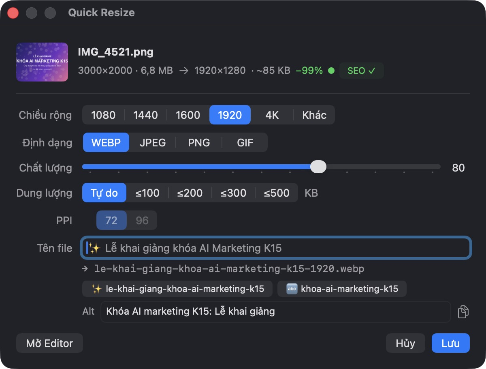
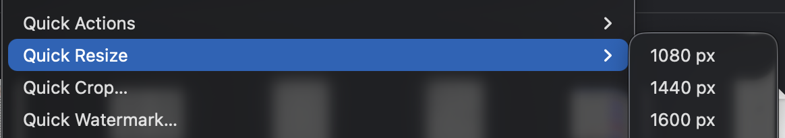

<div align="center">


# PixSEO

### 右键一下：图片更小、尺寸正确、文件名符合 SEO

在 macOS 访达（Finder）右键菜单里直接缩放、裁剪、加水印并按 SEO 规范重命名图片。<br>
**免费 · 离线运行 · 无需账号 · 开源**

[](https://github.com/khiemnguyendinh/pixseo/releases/latest)


[](LICENSE)

[Tiếng Việt](README.md) · [English](README.en.md) · **中文** · [日本語](README.ja.md) · [한국어](README.ko.md) · [Español](README.es.md)



</div>

> **说明：** 目前应用界面为越南语（专为越南内容团队设计），但操作流程与语言无关，下文附有关键按钮的翻译。

---

## 为什么选择 PixSEO？

把一张照片放到网站上，通常要走 5 步：
1. 打开 Photoshop 或在线压缩工具；
2. 调整尺寸；
3. 导出；
4. 把 `IMG_4521.png` 改成有意义的名字；
5. 再手动改成符合 SEO 的格式。

用 PixSEO，只需 **右键 → 选尺寸 → 回车**。

| 之前 | 使用 PixSEO 后 |
|---|---|
| `IMG_4521.png` · 3000×2000 · **6.8 MB** | `le-khai-giang-khoa-ai-marketing-k15-1920.webp` · 1920×1280 · **约 85 KB** |
| 文件名毫无意义，搜索引擎看不懂 | 描述性文件名，含关键词和尺寸 |
| 图片过大拖慢网页 | 体积减少 **99%**，并删除 EXIF/GPS |
| 手写替代文本（alt） | 自动建议 alt 文本，保存后自动复制 |

> 原图 **永远不会被修改**。新文件保存在原图旁边，从不覆盖任何文件，还提供 **撤销**。

## 三个操作，就在访达里



### ⚡ Quick Resize：两秒完成缩放
- 菜单里直接选宽度：**1080 · 1440 · 1600 · 1920 · 4K**，或自定义。
- 导出 **WebP、JPEG、PNG、GIF**，GIF 保留动画。
- **文件大小上限**（≤ 100/200/300/500 KB）：自动找到合适的画质。
- **72 / 96 PPI**。
- 保存前预估大小，并用绿/黄/红标记。
- 批量处理上百张图片，自动编号命名。

### ✂️ Quick Crop：按主体智能裁剪


- 自由裁剪或常用比例：**1:1 · 4:5 · 3:4 · 2:3 · 3:2 · 4:3 · 16:9 · 9:16**，以及 **OG 1200×630**（社交分享图）。
- **自动对准主体**：裁剪框自动围绕人脸和主要物体，不会切掉人头。
- 旋转、翻转，方向键逐像素微调；批量裁剪时每张图各自对准主体。

### 🖋 Quick Watermark：为每张图打上品牌


- **文字**或 **Logo** 水印；选择字体与颜色（含取色器）。
- **拖动**定位，调整大小、透明度、旋转。
- **自动选择空白角落**，不压住人脸或文字。
- 保存为 **预设**，在 Quick Resize 中一步完成缩放和加水印。

### ✨ 智能 SEO，完全在本机运行
- 自动生成 SEO 文件名：小写、去除越南语声调、连字符、尺寸后缀。
- **识别图中文字**（OCR）生成文件名建议。
- **Apple Intelligence**（macOS 26）建议标题和 **alt 文本**，图片不会离开你的 Mac。
- **SEO ✓ 徽章** 检查：
  - 文件大小
  - 尺寸
  - 文件名
  - 格式
  - 元数据
  - alt 文本

## 一分钟安装

1. 从 [**Releases**](https://github.com/khiemnguyendinh/pixseo/releases/latest) 下载 **`PixSEO-x.y.z.dmg`**，把 **PixSEO** 拖到 **应用程序**。
2. 打开 PixSEO，系统提示无法验证时点 **完成**。
3. 打开 **系统设置 › 隐私与安全性**，在 PixSEO 旁点 **仍要打开**，再点 **打开**（只需一次）。
4. 若提示右键菜单未启用（“Menu chuột phải chưa bật”），点 **Bật ngay**（启用），并在“访达”中勾选 PixSEO。

> **为什么需要第 3 步？** PixSEO 免费开源，未使用付费的 Apple 开发者账号签名，因此 macOS 会询问一次。

## 隐私
- 无云端、无账号、无追踪，包括 AI 在内的所有处理都在本机完成。
- 导出的图片会删除 EXIF 和 GPS 位置信息。

## 从源码构建

```bash
xcode-select --install
scripts/test.sh
scripts/install.sh
scripts/make-dmg.sh
```

## 许可证

[MIT](LICENSE)。包含 [libwebp](https://chromium.googlesource.com/webm/libwebp)（BSD），见 [THIRD_PARTY_NOTICES](THIRD_PARTY_NOTICES)。如果 PixSEO 帮你节省了时间，欢迎点个 ⭐。
